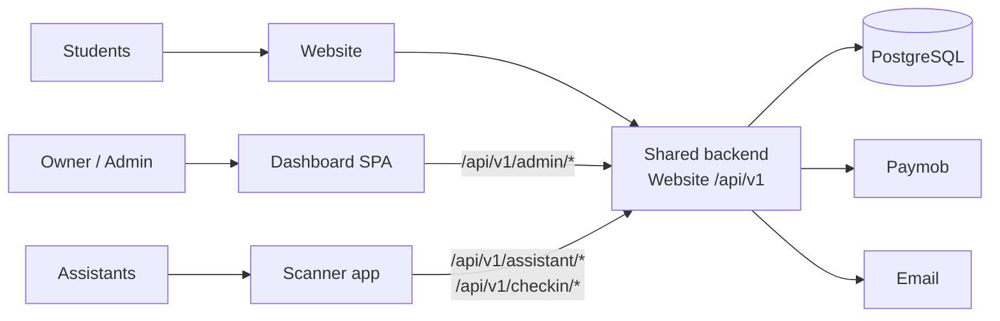

# Course Platform — Dashboard

**The owner's office for an in-person engineering course business: publish a cohort, see who paid, fix what needs a decision, and keep the public profile true. From a phone or a laptop, in Arabic first.**

> **Private and proprietary.** This repository, its documents and its code are not open source. Do not publish, fork or share without the owner's written permission.

The Dashboard is one of three apps in the **Engineer Course Platform** (Website · **Dashboard** · Scanner app). The Website sells seats and issues QR tickets; the Dashboard runs the business behind them; the Scanner app admits students at the classroom door. How they fit together: [`../SYSTEM.md`](../SYSTEM.md).

| | |
|---|---|
| **Status** | Phases D0–D12 done: every page is built and verified on a mock API. D13 (switch to the real API) waits for the Website backend. |
| **Users** | The Owner (the engineer) and an Admin (the operator). Assistants never use the Dashboard. |
| **Languages** | Arabic (right-to-left, the default) and English. |
| **Verified** | 86 unit/component tests, 47 browser tests (desktop and phone, English and Arabic), automated WCAG 2.2 AA scans, a 200 KB sign-in budget, security headers generated per build. |

---

## 1. The business

A practicing civil engineer in Cairo teaches in-person courses (structural design with ETABS, SAFE, Revit and the Egyptian code, ECP 203) at a training centre. Each course runs as **cohorts**: a session has dates, a place, a seat limit and a price.

**Before the platform,** students found him through social media and word of mouth, then booked by message, bank transfer and a screenshot of the receipt. That was slow, it lost interested students, it left seats unpaid or overbooked, and it gave nobody reliable proof of payment at the door.

**With the platform,** a student finds a course on the Website, pays online in three steps and gets a signed QR ticket. The Dashboard is what lets the engineer run that without a developer in the loop.

> The client identity in the docs ("Eng. Karim Mostafa" and the sample courses) is placeholder content until the client's own text and photos arrive. Nothing in the app claims real numbers, students or credentials beyond `Website/docs/DUMMY_DATA.md`.

## 2. The market

Students looking for practical structural-design training meet four kinds of offer (desk research, `docs/MARKET_RESEARCH.md` and `../Website/docs/MARKET_RESEARCH.md`):

| Offer | Strong at | Weak at |
|---|---|---|
| University course pages | Credible host, plain dates and fees | Text only, no instructor story, "contact this person" to register |
| Commercial training institutes | Full curriculum, outcomes, instructor bio | No price, no dates, every form ends in a sales call |
| Global online marketplaces | Low price, instant access | Recorded and generic, not the Egyptian code, no in-person practice. A different product |
| Local instructors (Egypt) | Personal trust, word of mouth | No owned website, details buried in social posts, manual payment by screenshot, no proof of booking |

**The gap:** no local competitor combines a credible personal brand of a *practicing* engineer, transparent dates, prices and seats, and instant online booking with a verifiable ticket. The platform is that combination; the Dashboard is what keeps it running without staff.

**What the audience implies:** mostly Android phones on mobile data, Arabic-first with English technical terms (ETABS, ECP 203), price-sensitive and comparing in Facebook groups. So the Dashboard is mobile-first, right-to-left by default, light on JavaScript, and honest about prices and seats.

**Legal context:** the owner stores student names, emails and phones. Egypt's Personal Data Protection Law (151/2020) executive regulations took effect on 1 November 2025, with the compliance grace period ending 31 October 2026 (per the research). The Dashboard is built for it: authenticated access, expiring sessions, no personal data in URLs or logs, exports recorded by the API. Licensing and appointing a data-protection officer are the client's legal tasks, to confirm with a lawyer. This is not legal advice.

## 3. The problem the Dashboard solves

| The owner's problem | What goes wrong |
|---|---|
| He can't add a course or a session himself | Every cohort waits for a developer |
| He doesn't know how many seats are sold | Someone has to count |
| A student says "I paid but have no ticket" | There is nowhere to look it up |
| A late payment arrives for a full session | It needs a decision, and nothing tells him |
| His bio, photo, credentials and numbers change | The website goes stale |
| Contact-form messages live only in email | Inquiries get lost |
| The first day of a session | The door needs a reliable list, and attendance has to be known afterwards |

## 4. The solution

One private place to **publish, sell, check and fix**. Seven areas, each answering one question:

| Area | The question it answers | What it does |
|---|---|---|
| **Home** | How is the business doing? | Revenue, paid registrations, seats filled, upcoming sessions, and a **Needs action** list (refund decisions, new messages, empty or closing sessions), with a six-month revenue trend |
| **Students** | Who is registered? | Search by name, phone, email or booking reference; filters; the student's page with booking, ticket and attendance; WhatsApp link; CSV export |
| **Payments** | Do the numbers reconcile, and what needs action? | Totals for the current filter; refund, move or cancel a booking; a history of every change; CSV export |
| **Courses** | What am I selling, and when? | Course cards, an "Add course" dialog, six tabs (overview, content, curriculum, sessions, FAQ, publishing), a checklist that blocks publishing until the bilingual essentials are there, sessions with meetings in Cairo time, and a "View on website" link |
| **Session** | Who's coming, and who came? | Roster, printable A4 attendance sheet for the door, per-meeting attendance with manual check-in and undo |
| **Assistants** | Who scans tickets at the door? | Profiles with photo and phone, activate or deactivate, delete only without history |
| **Messages** | Who wrote, and have I answered? | Inbox and archive, reading panel, reply by email or WhatsApp in the sender's language, live new-message count |
| **Profile** | What do students see about me, and is it right? | Seven independently saved tabs for the public profile: details, contact, bio, stats, certifications, journey, account (name, language, password) |

Also: a **quick search** (`/` on a keyboard, a search icon on a phone) that finds a booking by reference, phone or email from anywhere.

### Key journeys

1. **Publish a cohort:** Courses → Add course → content and curriculum → Add session → Publish → View on website. Target: under 15 minutes of the owner's time.
2. **Morning check:** Home → Needs action → the filtered payments → record the refund.
3. **A student says they paid:** quick search → the student's page → ticket status → WhatsApp them.
4. **Session day:** the session page → print the roster or mark attendance.
5. **Profile update:** Profile → edit in both languages → Save → View on website.

## 5. Strong points

**It protects the money and the seats.** The Dashboard cannot overbook: capacity can't be set below the seats already sold, and a course can't be published without its bilingual essentials. Refunds, moves and cancellations follow one set of rules shared by the screen and the mock API (`app/domain/money-rules.ts`), send an idempotency key so a double click or a retry can't apply twice, and refresh the page if someone else changed the booking first. The Dashboard only *records* refunds made in the Paymob portal; it never moves money. An independent review of these actions (done in D12) found seven issues, all fixed.

**It is built for how the owner works.** Right-to-left Arabic is the default and English is one tap away, remembered per account. The phone is a first-class screen: tables become stacked rows, dialogs fit, every page is checked at 360 px. Arabic numbers, phone numbers and booking references are isolated so they never render reversed.

**It is calm and fast to read.** One question per screen, one yellow action per view, status shown with a word and a marker, never by colour alone. Empty states say what will appear and offer one action. Unsaved changes are never lost silently (tabs and dialogs ask first).

**It is private by design.** Search terms never go in a URL, log or storage. Sessions expire (2 hours idle, 12 hours absolute). Tokens and personal data are never kept in the browser; the session is an httpOnly cookie set by the API, and signing out clears every cached record. A 401 mid-session explains itself and returns you to the same page and filters. The real API enforces every permission; the Dashboard only explains.

**It is accessible and checked.** Automated WCAG 2.2 AA scans run on every page and main dialog in both languages, on desktop and phone. Keyboard focus, labels and contrast are part of the Definition of Done, not an afterthought.

**It is light and hardened.** The sign-in page loads under the 200 KB (gzip) budget, enforced by `pnpm check:build`. Each build writes strict security headers (a content-security policy that allows scripts by hash, HSTS, no framing, `noindex`) for the host, and the check fails on any policy violation.

**It was built contract-first, so the backend can arrive late.** Every screen runs against a mock that answers the same endpoints, payloads and errors as the real API (`docs/SRS.md` §7.2). The Website backend can be built and tested independently, and switching over (D13) changes configuration, not screens. The mock never ships: the production build contains none of it.

**It is documented and traceable.** Every requirement has an ID (DSH, DBR, DAC, DUS), a page brief, a test and a row in the traceability table in `docs/PROGRESS.md`. Every assumption is logged in `docs/DECISIONS.md` (56 entries), and every API change is dated in the SRS revision history.

**It grows without a rewrite.** More branches, assistant shifts, a second instructor, coupons, waiting lists and notifications are modules on the same API and design language (scaling path in `../SYSTEM.md`).

## 6. How success is measured

Targets for the first three months (`docs/PRD.md`):

| Metric | Target |
|---|---|
| Sessions published by the owner himself, per month (north star) | Growing; no developer involved |
| From "new cohort decided" to bookable on the website | Under 15 minutes of owner time |
| Support lookups resolved from the Dashboard | 90 % or more |
| Refund-required cases handled within 48 hours | 100 % |
| New contact messages read within 24 hours | 90 % or more |
| Owner's weekly active use | 3 days a week or more |

**Guardrails that must never fail:** no action can overbook a session; no personal data is visible without an Owner or Admin session; no ticket stays valid after a recorded refund or cancellation; no published course lacks its bilingual essentials.

## 7. Part of the platform



- **Website** (Next.js) is also the backend. Students book and pay; tickets are issued.
- **Dashboard** (this repo) is the admin client of the Website's `/api/v1/admin/*`.
- **Scanner app** (React Native) is used by centre assistants at the door and writes attendance that the Dashboard shows within seconds.

## 8. Roadmap

| Phase | Status |
|---|---|
| D0–D3 Setup, plan, research, requirements, design system | Done |
| D4–D9 Foundation, UI kit, Home, Students, Payments, Courses, sessions and attendance | Done |
| D10 Assistants and profile | Done |
| D11 Messages, quick search, polish | Done |
| D12 QA and hardening (independent review, accessibility, budget, headers, print) | Done |
| D13 Real API switch (shared schema, contract tests, CORS and cookies, deploy) | Waiting for the Website backend |
| D14 Final independent review and client walkthrough | Next after D13 |
| Later | Activation codes and device revocation for the Scanner app (DSH-ASS-05), audit-log page, site settings, an interactive photo cropper |

**Waiting on the product owner:** two assumptions from D12 (`docs/DECISIONS.md`, DD-050 and DD-051): recording a refund for a cancelled booking, and keeping a refund-required student in the session they paid for when a seat has freed up.

**Out of scope for V1:** analytics suite, moving money through the gateway, marketing tools, an LMS, multiple instructors, student accounts, dark mode.

---

# For developers

**Stack:** React 19 · React Router 8 (framework mode, SPA) · Redux Toolkit + RTK Query · Tailwind CSS v4 · Radix UI · use-intl (AR/EN, RTL) · React Hook Form + Zod · MSW (mock API) · Vitest + Testing Library · Playwright.

## Getting started (Windows, macOS or Linux)

Requirements: Node.js 22 LTS or newer and [pnpm](https://pnpm.io) 11 (`corepack enable` picks the version pinned in `package.json`).

```bash
pnpm install
copy .env.example .env      # Windows (macOS/Linux: cp .env.example .env)
pnpm dev                 # http://localhost:5173
```

With `VITE_API_MOCKING=true` (the default in `.env.example`) the app answers every API call from an in-browser mock (MSW), so no backend is needed.

**Mock accounts** (mock only — the real API has its own users):

| Email | Role | Password |
|---|---|---|
| owner@example.com | Owner | `dashboard-demo` |
| admin@example.com | Admin | `dashboard-demo` |

Add `?mockError=500` to any page URL to see how a page handles API errors.
