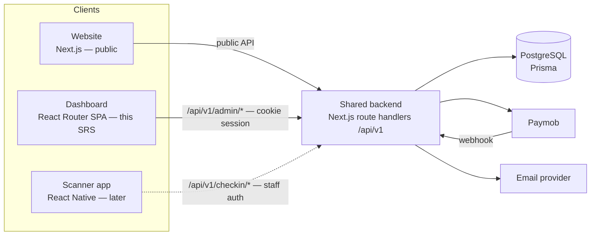
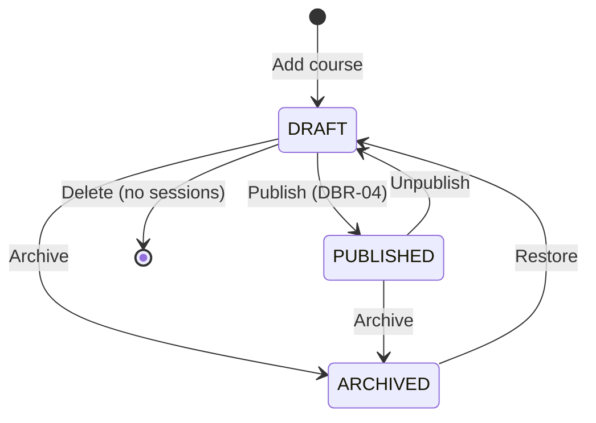
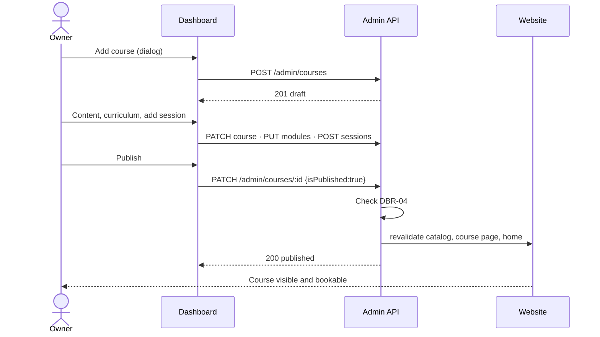

# Software Requirements Specification (SRS)

## Engineer Course Platform — Dashboard (Admin app), Version 1

| Item | Value |
| --- | --- |
| Document | Software Requirements Specification |
| Product | Dashboard: the owner's admin app for the course booking platform |
| System | One of three apps: **Website** · **Dashboard** · **Assistant Scanner app** (see `../SYSTEM.md`) |
| Release | Dashboard V1 |
| Document version | 1.0 — Draft for review |
| Date | 2026-10-03 |
| Prepared by | Mahmoud Samy (Frontend / Software Engineer) |
| Client | Civil engineer & course instructor (identity placeholder: "Eng. Karim Mostafa", Website `DUMMY_DATA.md`) |
| Status | Draft — pending product-owner approval |
| Companion documents | `docs/PRD.md` (this app) · `../Website/docs/SRS.md` (shared data model, business rules, QR format) · `docs/MARKET_RESEARCH.md` |

### Revision history

| Version | Date | Author | Change |
| --- | --- | --- | --- |
| 1.0 | 2026-10-03 | Mahmoud Samy | Initial Dashboard SRS: routes, functional requirements, admin API contract, data additions, NFRs, acceptance criteria |
| 1.1 | 2026-10-03 | Mahmoud Samy | Added `GET /admin/counts` for navigation badges (DD-026) |
| 1.2 | 2026-11-11 | Mahmoud Samy | `POST /admin/auth/password` answers 204, or 422 with `fields.currentPassword = INCORRECT` / `fields.newPassword = TOO_SHORT \| SAME` (DD-036); certifications carry `imageUrl` (DD-035) |

---

## Table of contents

1. Introduction
2. Overall description
3. Information architecture
4. Functional requirements
5. Business rules
6. Data requirements
7. External interface requirements
8. Non-functional requirements
9. Acceptance criteria
10. Scope boundaries
11. Assumptions, dependencies and open questions
12. Traceability
13. Appendices

---

## 1. Introduction

### 1.1 Purpose

This document specifies **what the Dashboard must do**: the behavior, data, interfaces and quality attributes of the admin application used by the engineer (owner) and the operator (admin) to run the course business that the Website sells. It is the source of truth for design, implementation and testing of the Dashboard, and it defines the **admin API contract** the shared backend must implement.

### 1.2 Product vision

The Website turns visitors into paid, ticketed students. The Dashboard is where the business behind it is run: **publish courses and sessions, see who booked and paid, handle the exceptions, and keep the engineer's public profile current**, from a laptop or a phone, in Arabic or English, without asking a developer.

### 1.3 Scope

**In scope (Dashboard V1):** sign-in with roles · Home overview · Students (registrations) · Payments · Courses with sessions, meetings, curriculum, FAQ and publishing · session roster and attendance · Assistants (profiles for the future Scanner app) · Profile (instructor public data, certifications, journey) · Messages inbox · CSV exports · bilingual AR/EN with RTL.

**Out of scope:** the Assistant Scanner app and its check-in UI, initiating refunds through the gateway, coupons, waiting lists, automated SMS/WhatsApp, multi-instructor management UI, student accounts (§10.2).

**System scaling (how this app grows):**

| Stage | What changes | Dashboard impact |
| --- | --- | --- |
| **Now (V1)** | One instructor, one or two branches, website + dashboard | This SRS. The dashboard runs against a mock API (MSW) until the backend's admin API exists |
| **Scanner app** | Assistants scan QR tickets at the door | Assistants get app access (invite/PIN) from the Assistants page; check-ins appear live in attendance |
| **Growth** | More branches, more sessions, a second instructor | Locations management, instructor filter, fine-grained permissions (the role model is ready) |
| **V2 ideas** | Refunds from the dashboard, coupons, waiting lists, WhatsApp notifications, reports | New modules on the same API and design system; no rewrite |

### 1.4 Definitions

| Term | Meaning |
| --- | --- |
| Owner | The engineer (client). Full access to his business |
| Admin | The operator (developer/assistant manager). Same access as Owner except account ownership actions |
| Assistant | Center staff who scan tickets with the Scanner app. **No dashboard access** |
| Course | A course offered by the engineer (Website DR-05) |
| Session | One run of a course with dates, location, capacity and price (DR-09). Students book a session |
| Meeting | One class meeting of a session (DR-10) |
| Registration | A booking (DR-13) that reached a payment outcome; one student in one session |
| Roster | The list of registrations for one session |
| Check-in | A recorded attendance of a ticket at a meeting (DR-16) |
| Needs action | Items requiring a human decision: `REFUND_REQUIRED` bookings, new messages, sessions near their cut-off with problems |
| MSW | Mock Service Worker — intercepts HTTP requests in the browser and answers from an in-memory mock database |
| Piasters | Integer money unit, 1 EGP = 100 piasters (Website C-03) |

### 1.5 Conventions

- IDs: functional `DSH-<AREA>-nn`, business rules `DBR-nn`, data `DR-nn` (continues the shared Website numbering), non-functional `DNFR-<AREA>-nn`, acceptance criteria `DAC-nn`, user stories `DUS-nn` (PRD).
- Priority: **Must** (V1 blocker) · **Should** (V1 if time allows, planned) · **Could** · **Later** (specified, built in a later release).
- "The system" = the Dashboard **and** the backend admin API where the rule must be enforced on the server.

### 1.6 References

`../SYSTEM.md` · `../Website/docs/SRS.md` v1.1 (DR-01…DR-19, BR-01…BR-20, §4.12, §6.3–6.5) · `docs/PRD.md` · `docs/MARKET_RESEARCH.md` · `docs/DESIGN_SYSTEM.md` · React Router 8 docs (`node_modules/react-router/docs/`) · Egypt PDPL Law 151/2020 and its executive regulations (effective 2025-11-01).

---

## 2. Overall description

### 2.1 Product perspective



- The **Website app owns the shared backend** (Website SRS §2.1). The Dashboard is a static SPA with no server of its own; every read and write goes through `/api/v1/admin/*` (§7.2).
- The Dashboard and the Website share the **same data model** (Website §6 + additions in §6 here). Content the owner edits (profile, courses, sessions) is what the Website shows.
- Until the backend implements the admin API, the Dashboard runs on an **MSW mock API** that follows the same contract (§7.4). Switching to the real backend is a configuration change.

### 2.2 Product functions

1. Sign in, keep a session, sign out; role-based access.
2. Show an overview: revenue, bookings, seat fill, needs-action items, latest payments and registrations, upcoming sessions.
3. List, search, filter and export student registrations; open a student's details and attendance.
4. List, search, filter and export payments; record refunds and resolve `REFUND_REQUIRED` bookings.
5. Create, edit, publish and archive courses; manage curriculum and FAQ.
6. Create and manage sessions and meetings; close registration; view and print the roster.
7. View and correct attendance per meeting.
8. Manage assistant profiles (future Scanner app users).
9. Edit the instructor's public profile, contact channels, certifications and journey.
10. Read and triage contact messages.

### 2.3 User classes and roles

| Role | Who | Access |
| --- | --- | --- |
| **OWNER** | The engineer | Everything. Only an Owner can manage admin users (later) |
| **ADMIN** | Operator (Mahmoud) | Everything except managing admin users |
| **ASSISTANT** | Center staff | Scanner app only (later). Cannot sign in to the Dashboard |

**Permission matrix (V1):**

| Capability | OWNER | ADMIN | ASSISTANT |
| --- | --- | --- | --- |
| View Home, Students, Payments, Courses, Messages | ✅ | ✅ | — |
| Create/edit/publish courses, sessions, meetings | ✅ | ✅ | — |
| Record refund, resolve refund-required, cancel booking | ✅ | ✅ | — |
| Manual attendance (mark / undo) | ✅ | ✅ | Scanner app only (later) |
| Export CSV | ✅ | ✅ | — |
| Manage assistants | ✅ | ✅ | — |
| Edit instructor profile | ✅ | ✅ | — |
| Manage admin users | ✅ (later) | — | — |

Permissions are enforced **by the API**. The Dashboard hides what a role can't do, but hiding is never the protection (DNFR-SEC-02).

### 2.4 Operating environment

- Modern evergreen browsers; **phone (360 px+) and desktop** are both first-class (MARKET_RESEARCH §1).
- Static hosting for the built SPA (`build/client`), e.g. Vercel or Netlify, at `dashboard.{domain}` with all paths rewritten to `index.html`.
- The admin API is served by the Website backend at `{domain}/api/v1/admin` (same site, different subdomain).
- Business timezone **Africa/Cairo** (IANA, DST-aware — never fixed offsets). Timestamps are stored in UTC.

### 2.5 Design and implementation constraints

| ID | Constraint |
| --- | --- |
| DC-01 | **Stack (product owner):** React **19**, **React Router 8 in framework mode with `ssr: false` (SPA mode)**, **Redux Toolkit + RTK Query** (latest) for state, caching and API integration, **Tailwind CSS v4**, **Radix UI primitives** (`radix-ui`) for accessible behavior (Dialog, AlertDialog, DropdownMenu, Tabs, Select, Popover, Tooltip, Toast, Checkbox, Switch, RadioGroup, Avatar, ScrollArea…), TypeScript strict. |
| DC-02 | **Data rule:** all server state goes through **RTK Query** endpoints (one `api` slice, endpoints injected per feature, tag-based invalidation). Redux slices hold only client state (session user, UI preferences). No `useEffect` fetching. Route `clientLoader`s may prefetch through RTK Query (`api.endpoints.x.initiate`) so data starts loading with navigation. |
| DC-03 | Radix Primitives has **no Table component**. Tables are semantic `<table>` elements styled with design tokens (a shared `DataTable` component). Radix Themes is not used because it brings its own visual system that conflicts with the brand tokens. |
| DC-04 | Forms: React Hook Form + Zod (same as the Website). Zod schemas mirror the API validation; the server re-validates everything. |
| DC-05 | i18n: `use-intl` (the framework-agnostic core of `next-intl` used by the Website) so message format (ICU) and conventions match. Arabic is the default locale. |
| DC-06 | Money is integers in piasters; formatting with `Intl.NumberFormat`; Latin digits in both locales (Website Q-12). |
| DC-07 | Dates are entered and shown in **Africa/Cairo**; sent to the API as UTC ISO strings. |
| DC-08 | No server code in the Dashboard. No secrets in the bundle. Environment values are public by definition (`VITE_*`): API base URL and mock switch only. |
| DC-09 | Mock API: **MSW** with an in-memory database seeded from the Website placeholder data, enabled with `VITE_API_MOCKING=true` in development and tests. Never shipped in production builds. |
| DC-10 | Design follows `docs/DESIGN_SYSTEM.md` (derived from the Website's "Drawing Sheet" identity) and the project skills; no generic admin-template look. |

### 2.6 Assumptions

Single instructor; Owner and Admin are the only dashboard users in V1; courses are in person; refunds are executed in the Paymob portal and recorded in the Dashboard; the shared backend (Website Phase 8) will implement §7.2. Full list: §11.

---

## 3. Information architecture

### 3.1 Sitemap

```
/login
/                         Home (overview)
/students                 Registrations table
/students/:studentId      Student details (bookings, attendance)
/payments                 Payments table (+ details drawer ?payment=)
/courses                  Course cards  [Add course → dialog]
/courses/:courseId        Course details: Overview · Content · Curriculum · Sessions · FAQ · Publishing
/courses/:courseId/sessions/:sessionId   Session: details, roster, attendance
/assistants               Assistant cards [Add assistant → dialog]
/messages                 Contact messages inbox (+ ?message=)
/profile                  Instructor profile: Personal · Contact · Bio · Stats · Certifications · Journey · Account
*                         Not found
```

### 3.2 Routes

| Route | Page | Access | Priority |
| --- | --- | --- | --- |
| `/login` | Sign in | Public (redirects to `/` if signed in) | Must |
| `/` | Home | OWNER, ADMIN | Must |
| `/students` | Students | OWNER, ADMIN | Must |
| `/students/:studentId` | Student details | OWNER, ADMIN | Must |
| `/payments` | Payments | OWNER, ADMIN | Must |
| `/courses` | Courses | OWNER, ADMIN | Must |
| `/courses/:courseId` | Course details (tabs via `?tab=`) | OWNER, ADMIN | Must |
| `/courses/:courseId/sessions/:sessionId` | Session & roster | OWNER, ADMIN | Must |
| `/assistants` | Assistants | OWNER, ADMIN | Must |
| `/messages` | Messages | OWNER, ADMIN | Should |
| `/profile` | Profile (tabs via `?tab=`) | OWNER, ADMIN | Must |
| `*` | Not found | — | Must |

The UI language is a user preference (stored per user, default `ar`), not part of the URL: the Dashboard is private, so locale URLs bring no SEO value.

### 3.3 Navigation and layout

| ID | Requirement | Priority |
| --- | --- | --- |
| DSH-NAV-01 | An **app shell** wraps all signed-in pages: a start-side navigation rail (desktop ≥ 1024 px) with the brand block, the main routes (Home, Students, Payments, Courses, Assistants, Messages, Profile), the language switch and the signed-in user menu. Each page opens with a page header (the `h1`, a description, and its actions). | Must |
| DSH-NAV-02 | Below 1024 px the navigation collapses into a top bar (menu button, product name, language switch); the menu opens an accessible drawer (Radix Dialog) from the inline-start edge. The page title stays visible as the page header `h1`. | Must |
| DSH-NAV-03 | The current route is marked (`aria-current="page"`) and visually distinct (not by color alone). | Must |
| DSH-NAV-04 | Navigation badges show counts that need attention: Payments (refund-required), Messages (new). | Should |
| DSH-NAV-05 | Each page has exactly one `h1` (the page title) and, at most, one primary (yellow) action in its header. | Must |
| DSH-NAV-06 | Detail pages show a back link to their parent list, preserving the list's filters. | Must |

---

## 4. Functional requirements

### 4.1 Global (DSH-GEN)

| ID | Requirement | Priority |
| --- | --- | --- |
| DSH-GEN-01 | The Dashboard is a client-rendered SPA (React Router framework mode, `ssr: false`). The root route renders a branded `HydrateFallback` into `index.html` so the first paint is not blank. | Must |
| DSH-GEN-02 | Bilingual UI: Arabic (RTL, default) and English (LTR). `lang` and `dir` are set on `<html>`; layout uses logical properties; directional icons mirror. Switching language applies immediately and is saved to the user's preference. | Must |
| DSH-GEN-03 | Content that exists in both languages (course titles, bio…) is edited side by side (AR and EN fields) and displayed in the UI language. | Must |
| DSH-GEN-04 | List state that is safe to share (page, page size, sort, status/course/date filters, active tab) lives in the **URL search params** so refresh, back/forward and links work. Free-text search terms (which may contain phone numbers or emails) are **not** written to the URL. | Must |
| DSH-GEN-05 | Every async action has loading, success and error feedback: skeletons for content, inline spinners for actions, toasts (Radix Toast) for completed mutations, inline messages for errors. Buttons keep their label while loading and prevent double submission. | Must |
| DSH-GEN-06 | Forms with unsaved changes warn before navigation (React Router `useBlocker`) and before closing a dialog. | Should |
| DSH-GEN-07 | Errors: a route `ErrorBoundary` per section explains what happened and offers Retry / Back; network failures show a retry banner; 401 sends the user to `/login?next=` and returns them after sign-in; 403 shows "You don't have access to this". | Must |
| DSH-GEN-08 | Destructive or irreversible actions (archive course, cancel booking, record refund, deactivate assistant, undo check-in) use a confirmation dialog (Radix AlertDialog) that names the object and the consequence. | Must |
| DSH-GEN-09 | Money is shown as `3,200 EGP` / `3,200 ج.م` with tabular figures; dates and times in `Africa/Cairo`, unambiguous for the locale (e.g. "Sat 17 Oct 2026, 10:00"). Codes, references and phone numbers are isolated (`dir="ltr"`). | Must |
| DSH-GEN-10 | A development-only banner shows "Mock data" when MSW is active. | Must |
| DSH-GEN-11 | Data freshness: lists refetch on window focus and on reconnect; Home and Payments also poll every 60 s while visible. | Should |
| DSH-GEN-12 | A global quick search (in the navigation, `/` shortcut) finds a booking by reference, phone or email and opens the student. | Could |

### 4.2 Authentication (DSH-AUTH)

| ID | Requirement | Priority |
| --- | --- | --- |
| DSH-AUTH-01 | `/login` asks for email and password, with show/hide password, and signs in through `POST /admin/auth/login`. | Must |
| DSH-AUTH-02 | Wrong credentials show one generic message ("Email or password is incorrect"). After 5 failed attempts in 15 minutes for an email or IP, sign-in is blocked for 15 minutes with a clear message. | Must |
| DSH-AUTH-03 | A successful sign-in creates a server session held in an **httpOnly, Secure, SameSite=Strict cookie**. The Dashboard never stores tokens in `localStorage`. | Must |
| DSH-AUTH-04 | All signed-in routes are guarded by a `clientMiddleware` on the app layout that loads `GET /admin/auth/me` (cached in RTK Query); no session → redirect to `/login?next=<path>`. | Must |
| DSH-AUTH-05 | Sessions expire after 12 hours, or after 2 hours idle. On expiry the next request returns 401; the user is told "Your session has ended. Sign in again." and returned to where they were. | Must |
| DSH-AUTH-06 | Sign out ends the server session, clears the RTK Query cache and Redux state, and returns to `/login`. | Must |
| DSH-AUTH-07 | Forgot password: V1 shows "Contact the administrator" (single owner/admin). Self-service reset is Later. | Must (message) / Later (reset) |
| DSH-AUTH-08 | A signed-in user can change their own password (current + new, min 10 characters) on Profile → Account. | Should |

### 4.3 Home (DSH-HOME)

| ID | Requirement | Priority |
| --- | --- | --- |
| DSH-HOME-01 | A **KPI strip** (title-block style) with: **Revenue this month** (net of refunds, vs last month), **Paid registrations this month** (vs last month), **Seats filled** in upcoming sessions (sold / capacity and %), **Upcoming sessions** in the next 30 days. Each value has a label and a short comparison in words, not only an arrow or color. | Must |
| DSH-HOME-02 | **Needs action** panel listing items that require a decision, each with a direct action: refund-required bookings (→ Payments filtered), new messages (→ Messages), published sessions starting within 7 days with 0 registrations, and sessions whose registration closes within 48 hours with seats left (informational). Empty state: "Nothing needs your attention." | Must |
| DSH-HOME-03 | **Revenue trend**: net revenue per month for the last 6 months (bars) with the values available as text/table for screen readers. Fewer than 4 months of data → show totals instead of a chart. | Should |
| DSH-HOME-04 | **Latest payments**: the 5 most recent payments (time, student, course, amount, status) with "View all" → Payments. | Must |
| DSH-HOME-05 | **Latest registrations**: the 5 most recent paid registrations (student, course/session, time) with "View all" → Students. | Must |
| DSH-HOME-06 | **Upcoming sessions**: the next 5 sessions with date, course, location, a seats bar (sold/capacity + number) and status (BR-12), each linking to the session page. | Must |
| DSH-HOME-07 | All Home data comes from one `GET /admin/overview` call (plus the latest lists) to keep the first view fast. | Should |
| DSH-HOME-08 | Empty system (no courses yet): Home shows a short start guide: "Add your first course → add a session → publish". | Should |

### 4.4 Students (DSH-STU)

A **row is a registration** (a booking that reached a payment outcome: `PAID`, `REFUND_REQUIRED`, `CANCELLED`, `REFUNDED`). A student with two courses appears twice; the student details page groups them.

| ID | Requirement | Priority |
| --- | --- | --- |
| DSH-STU-01 | Table columns: **Student** (name + department), **Phone** (with WhatsApp link), **Course** (title + session code), **Registered** (date/time), **Booking status**, **Attendance** (§4.8), **Reference**. Email is shown on details, not in the table, to keep rows readable. | Must |
| DSH-STU-02 | Search (debounced 300 ms) by name, phone, email or booking reference. | Must |
| DSH-STU-03 | Filters: course, session (dependent on course), booking status (default: **Paid**), attendance status, registration date range (presets: this week, this month, last 30 days, custom). Active filters are shown as removable chips with "Clear all". | Must |
| DSH-STU-04 | Sort by registration date (default newest), name, course. Server-side pagination: 25 per page (options 10/25/50), with "Showing 26–50 of 312". | Must |
| DSH-STU-05 | Row click (or the name link) opens `/students/:studentId`: contact details, department, consent date, all registrations with ticket status, per-meeting attendance, payment history, and actions (WhatsApp, email, copy reference). | Must |
| DSH-STU-06 | **Export CSV** of the current filter (all pages, max 10,000 rows) with UTF-8 BOM so Excel shows Arabic correctly. Columns: reference, name, phone, email, department, course, session, registered at (Cairo), status, attendance. The export is recorded in the audit log. | Should |
| DSH-STU-07 | Mobile (< 768 px): rows become stacked list items (name, course, status, date) with the same filters in a sheet. | Must |
| DSH-STU-08 | Empty states: no registrations yet ("Registrations appear here after students pay on the website"), and no results for the filters ("No registrations match these filters" + Clear filters). | Must |

### 4.5 Payments (DSH-PAY)

| ID | Requirement | Priority |
| --- | --- | --- |
| DSH-PAY-01 | Table columns: **Date**, **Reference**, **Student**, **Course / session**, **Method** (Card / Wallet), **Amount** (end-aligned), **Payment status** (`INITIATED` Pending, `SUCCEEDED` Paid, `FAILED` Failed, `REFUNDED` Refunded), **Booking status** when it needs attention (e.g. Refund required). | Must |
| DSH-PAY-02 | A **summary bar** for the current filter: gross paid, refunded, net, and count. | Must |
| DSH-PAY-03 | Search by reference, gateway transaction ID, student phone or email. Filters: payment status, method, course, date range; quick filter **Needs action** (booking `REFUND_REQUIRED`). Sort by date (default newest) or amount. Server pagination as DSH-STU-04. | Must |
| DSH-PAY-04 | Selecting a row opens a **details drawer** (Radix Dialog as a side sheet, URL `?payment=<id>`): amounts, gateway IDs (copyable), timeline (initiated → succeeded/failed → refunded) with times, the booking, the student, and available actions. | Must |
| DSH-PAY-05 | **Record refund** (OWNER/ADMIN) for a `SUCCEEDED` payment whose booking is `PAID` or `REFUND_REQUIRED`: amount (default full, partial allowed down to 1 EGP), the Paymob refund transaction ID (required), and a note. Result: payment `REFUNDED`, booking `REFUNDED`, ticket `CANCELLED` (Website state machines). V1 records a refund done in the Paymob portal; it does not move money. | Must |
| DSH-PAY-06 | **Resolve refund-required by moving the student**: choose another session of the same course with free seats → booking becomes `PAID` in the new session and a ticket is issued (Website BR-09). The amount difference, if any, is shown and must be handled manually. | Should |
| DSH-PAY-07 | **Cancel booking** for a `PAID` booking (e.g. the student withdrew and the refund is pending): booking `CANCELLED`, ticket `CANCELLED`, seat released. Requires a reason. | Should |
| DSH-PAY-08 | Export CSV of the current filter (as DSH-STU-06). | Should |
| DSH-PAY-09 | Raw gateway payloads are never shown in the UI (they're PII-redacted on the server and stay there). | Must |

### 4.6 Courses (DSH-CRS)

| ID | Requirement | Priority |
| --- | --- | --- |
| DSH-CRS-01 | `/courses` shows **course cards** in a responsive grid (1 column mobile, 2 tablet, 3 desktop). Card: generated sheet cover (code + discipline, as on the Website), title, publication state (Draft / Published / Archived), computed course status (Website BR-13: Available, Almost full, Fully booked, Coming soon, Closed), next session date, seats sold/capacity of the next session, number of upcoming sessions, base price. | Must |
| DSH-CRS-02 | Status tabs: **All · Published · Drafts · Archived** with counts; search by title or code. Archived courses are hidden from "All". | Must |
| DSH-CRS-03 | The page header has one primary action **Add course** that opens a **Radix Dialog** with the essentials: title (AR, EN), course code (3 letters, unique, used in session codes), level, base price (EGP), total hours, meetings count, short description (AR, EN). Slug is generated from the English title and editable. Save creates a **Draft** and navigates to the new course's details page. | Must |
| DSH-CRS-04 | `/courses/:courseId` has tabs (Radix Tabs, `?tab=`): **Overview** (essentials + cover alt text), **Content** (about, audience, problem solved, expectations, outcomes list, requirements list, what to bring — AR/EN), **Curriculum** (modules: order, title, hours, topics; add, edit, reorder, delete), **Sessions** (§4.7), **FAQ** (course questions: add, edit, reorder, delete), **Publishing** (§ below). Each tab saves independently with its own Save button and unsaved-changes guard. | Must |
| DSH-CRS-05 | **Publishing** tab: Published switch, Featured on home switch, Coming soon switch + note (AR/EN), Close registration switch, SEO title/description (AR/EN, with character counters). Publishing is blocked until the requirements in DBR-04 are met; the tab lists what's missing with links to the tab that fixes it. | Must |
| DSH-CRS-06 | **Preview on website**: opens the course's public page in a new tab (published courses) — for drafts, shows "Publish to preview on the website" (no draft preview in V1). | Should |
| DSH-CRS-07 | **Archive** (instead of delete) for courses with any bookings: hidden from the Website and from "All"; sessions with paid registrations keep working. **Delete** is offered only for drafts with no sessions. **Restore** returns an archived course to Draft. | Must |
| DSH-CRS-08 | Card and list order on the Website follows `sortOrder`; the owner can reorder published courses (move up/down on the card menu). | Could |
| DSH-CRS-09 | Empty state: "Add your first course" with the Add course action. | Must |

### 4.7 Sessions & meetings (DSH-SES)

| ID | Requirement | Priority |
| --- | --- | --- |
| DSH-SES-01 | The course **Sessions** tab lists the course's sessions (upcoming first, then past): code, label, location, first and last meeting, meetings count, seats sold/capacity with a bar, price, computed status (BR-12), published state. | Must |
| DSH-SES-02 | **Add session** (Radix Dialog): location (select), capacity (1–500), price (defaults to the course base price), label (AR/EN, prefilled e.g. "October cohort — Saturdays"), meetings (date, start time, end time — add/remove rows; at least one; quick "repeat weekly × N" helper), registration closes at (default: 24 h before the first meeting, DBR-07), published switch. The session code is generated (`{COURSE3}-{YYMM}-{A..Z}`, Website §6.4) and shown read-only. | Must |
| DSH-SES-03 | Meetings are entered and displayed in **Africa/Cairo** wall-clock time and sent as UTC. End must be after start; meetings must not overlap and are ordered by start. | Must |
| DSH-SES-04 | Edit session with protection rules (DBR-05…DBR-08): capacity can't go below paid + held seats; price changes don't affect existing bookings and show a notice saying so; editing meetings of a session with paid registrations requires confirmation ("Students who already booked will not be notified automatically in V1"). | Must |
| DSH-SES-05 | **Close registration** / **Reopen registration** (manual close, Website BR-07/BR-12). | Must |
| DSH-SES-06 | **Delete** only for sessions with no bookings; otherwise **Unpublish** (hidden on the Website, existing tickets stay valid). | Must |
| DSH-SES-07 | `/courses/:courseId/sessions/:sessionId` shows the session facts (title block), the **roster** (registrations with reference, name, phone, department, booking status, attendance per meeting), and actions: Edit, Close/Reopen registration, **Print roster**, **Export CSV**. | Must |
| DSH-SES-08 | **Print roster**: a print stylesheet producing an A4 list (course, session, meeting date selector, reference, name, phone, a blank signature/check column) for use at the door before the Scanner app exists. | Should |

### 4.8 Attendance (DSH-ATT)

| ID | Requirement | Priority |
| --- | --- | --- |
| DSH-ATT-01 | Attendance comes from check-ins (Website DR-16). The roster shows a meeting-by-meeting grid (✓ attended with time and who checked in, — not attended, blank for future meetings). | Must |
| DSH-ATT-02 | Derived **attendance status** per registration (shown in Students and the roster): **Upcoming** (no meeting has started), **Attended n of m** (at least one check-in), **Absent** (≥ 1 past meeting and no check-ins), **Completed n of m** (session ended). Only `PAID` registrations have attendance. | Must |
| DSH-ATT-03 | OWNER/ADMIN can **mark attended** for a meeting that has started (manual check-in, recorded with their user ID as `checkedInBy` and source `DASHBOARD`) and **undo** a check-in with a confirmation. Future meetings can't be marked. | Should |
| DSH-ATT-04 | Check-ins made by the Scanner app appear without reload when the roster is open (polling 30 s on the session page during a meeting's time window). | Later |

### 4.9 Assistants (DSH-ASS)

| ID | Requirement | Priority |
| --- | --- | --- |
| DSH-ASS-01 | `/assistants` shows **assistant cards**: photo or initials avatar, name, phone (WhatsApp link), email (optional), status (Active / Inactive), app access (V1: "Scanner app — coming soon"; later: Not invited / Invited / Active with last activity), and notes. | Must |
| DSH-ASS-02 | Header primary action **Add assistant** opens a Radix Dialog: full name (required), phone (required, Egyptian mobile format, stored E.164), email (optional), photo (optional, JPG/PNG/WebP ≤ 2 MB, cropped square), notes (optional, internal). | Must |
| DSH-ASS-03 | Edit an assistant (same dialog). **Deactivate / Activate** (deactivated assistants can't use the Scanner app; their past check-ins remain). **Delete** only when the assistant has no check-ins. | Must |
| DSH-ASS-04 | Filter: Active / Inactive / All; search by name or phone. Empty state explains what assistants are for ("Assistants will scan student tickets at the door with the mobile app"). | Must |
| DSH-ASS-05 | **Invite to the Scanner app** (one-time code or PIN, revoke access) — specified with the Scanner app SRS. | Later |

### 4.10 Profile (DSH-PRO)

Edits the instructor record shown on the Website (Website DR-01…DR-04). Saving makes the change live on the Website (the backend revalidates the affected pages).

| ID | Requirement | Priority |
| --- | --- | --- |
| DSH-PRO-01 | Tabs (`?tab=`): **Personal** · **Contact** · **Bio** · **Stats** · **Certifications** · **Journey** · **Account**. | Must |
| DSH-PRO-02 | **Personal**: name, short name, title, specialization (AR/EN each); photo upload (JPG/PNG/WebP ≤ 5 MB, min 800×1000, 4:5 crop) with required alt text (AR/EN). The photo preview shows the 4:5 crop used on the Website hero. | Must |
| DSH-PRO-03 | **Contact**: phone, WhatsApp number (E.164, with a "Same as phone" option), public email, social links (LinkedIn, Facebook, YouTube, Instagram — URL validated). | Must |
| DSH-PRO-04 | **Bio**: positioning statement, value proposition, short bio, long bio (paragraph list), audience (list) — AR/EN side by side with character guidance matching the Website layout. | Must |
| DSH-PRO-05 | **Stats**: the 4 hero stats (years, students, cohorts, projects): value + label (AR/EN). A notice reminds that numbers must be true (Website rule: no invented claims). | Should |
| DSH-PRO-06 | **Certifications**: list with name, issuer (AR/EN), year, credential URL (optional), image (optional); add, edit, reorder, delete. | Should |
| DSH-PRO-07 | **Journey**: milestones with type (Education / Engineering / Teaching / Milestone), start year, end year or "present" or single point, title, organization, description (AR/EN); add, edit, reorder, delete. Validation: end ≥ start. | Should |
| DSH-PRO-08 | **Account**: the signed-in user's name, email, UI language preference, change password (DSH-AUTH-08). | Must (language) / Should (password) |
| DSH-PRO-09 | A "View on website" link opens the public home page. | Should |

### 4.11 Messages (DSH-MSG)

| ID | Requirement | Priority |
| --- | --- | --- |
| DSH-MSG-01 | `/messages` lists contact messages (Website DR-17) newest first: sender, subject, first line, course (if any), received time, status (New / Read / Archived). Tabs: Inbox (New + Read) · Archived. | Should |
| DSH-MSG-02 | Opening a message (`?message=<id>`) shows it in full with sender details and marks it **Read**. Actions: Reply by email (`mailto:` with subject), Reply on WhatsApp (if phone given), Mark as new, Archive / Unarchive. | Should |
| DSH-MSG-03 | The navigation shows the count of New messages (DSH-NAV-04). | Should |

### 4.12 Exports and audit (DSH-EXP)

| ID | Requirement | Priority |
| --- | --- | --- |
| DSH-EXP-01 | CSV exports (Students, Payments, Roster) are generated by the API (`GET …/export.csv` with the same filters) so large exports don't depend on the browser. | Should |
| DSH-EXP-02 | The API writes an **audit log** entry (DR-22) for: sign-in/out, failed sign-in, create/update/publish/archive/delete of courses, sessions, meetings, assistants, profile; refund recorded; booking cancelled or moved; manual check-in/undo; exports. | Should (API) |
| DSH-EXP-03 | An Activity page listing the audit log (filter by user, entity, date). | Later |

### 4.13 Not in V1 navigation but specified for growth

| ID | Requirement | Priority |
| --- | --- | --- |
| DSH-SET-01 | Settings: brand name, reference prefix, hold minutes, registration cut-off hours, almost-full threshold, show-exact-seats threshold, contact channels, working hours (Website DR-18). | Could |
| DSH-SET-02 | Locations: add/edit branches (Website DR-08). V1 uses seeded locations. | Could |
| DSH-SET-03 | Admin users management (OWNER only). | Later |

---

## 5. Business rules

The Website business rules **BR-01…BR-20 apply unchanged** (seat math, statuses, holds, tickets, refunds). These rules add what the Dashboard enforces. Every rule is enforced by the API; the UI explains it before the user hits it.

| ID | Rule |
| --- | --- |
| DBR-01 | Only authenticated `OWNER`/`ADMIN` users can call `/api/v1/admin/*`. `ASSISTANT` credentials are rejected by admin endpoints. |
| DBR-02 | Course `code` is 3 uppercase Latin letters, unique, and **immutable once any session exists** (it's embedded in session codes and printed on tickets). |
| DBR-03 | Course `slug` is unique, lowercase `a-z0-9-`, and immutable once the course has been published (public links); before that it can change. |
| DBR-04 | A course can be **published** only when: title, short description, about, at least 3 outcomes, at least 1 curriculum module, level, total hours, meetings count, base price > 0 and cover alt text exist in **both** languages where bilingual. A course with no published upcoming session is shown on the Website as Coming soon or Closed (BR-13). |
| DBR-05 | A session's `capacity` ≥ (paid bookings + active holds) at all times. |
| DBR-06 | Changing a session's price affects only new bookings (BR-06). |
| DBR-07 | `registrationClosesAt` defaults to 24 h before the first meeting and must be before the first meeting's start. |
| DBR-08 | A session's meetings: ≥ 1, each `endsAt > startsAt`, non-overlapping, and the first meeting must be in the future when the session is created. |
| DBR-09 | A session can be **deleted** only with no bookings in any status; otherwise it can be unpublished. A course can be deleted only when it's a draft with no sessions; otherwise archived. |
| DBR-10 | Session code `{COURSE3}-{YYMM}-{A..Z}` uses the course code, the year-month of the first meeting (Cairo time) and the next free letter for that course and month. |
| DBR-11 | A refund can be recorded only for a `SUCCEEDED` payment, with amount 1 EGP ≤ amount ≤ remaining refundable amount, and a gateway refund transaction ID. Recording it sets payment `REFUNDED`, booking `REFUNDED` and ticket `CANCELLED` (also for partial refunds — the seat is released). |
| DBR-12 | Moving a `REFUND_REQUIRED` booking needs a target session of the same course with remaining seats ≥ 1; the move is atomic (seat check + status change in one transaction, Website NFR-SEC-07). |
| DBR-13 | Manual check-in is allowed only for `PAID` bookings with a `VALID`/`CHECKED_IN` ticket, for a meeting of their session that has started (from 60 minutes before start), once per meeting (BR-10). |
| DBR-14 | An assistant's phone is unique among assistants. An assistant with check-ins can't be deleted, only deactivated. |
| DBR-15 | At least one active `OWNER` must exist; an owner can't deactivate or demote themself. |
| DBR-16 | Bilingual content fields are required in both languages when the entity is published (DBR-04); drafts can be incomplete. |
| DBR-17 | Instructor stats and certifications must be truthful; the UI does not offer placeholder values (Website AGENTS rule). |

---

## 6. Data requirements

### 6.1 Shared model

The Dashboard uses the Website data model **DR-01…DR-19** as is (Website SRS §6.2), including bilingual `{ ar, en }` fields, piasters, UTC timestamps and the state machines in Website §6.3.

### 6.2 Additions required for the Dashboard

These are added to the shared Prisma schema when the backend implements the admin API (Website Phase 8+).

| ID | Entity / change | Key attributes |
| --- | --- | --- |
| DR-05a | **Course** (additions) | `code` (3 letters, unique), `archivedAt?`, `createdById`, `updatedById` |
| DR-09a | **Session** (additions) | `createdById`, `updatedById` |
| DR-16a | **CheckIn** (additions) | `source` (`SCANNER` / `DASHBOARD`), `checkedInBy` → AdminUser or Assistant, `undoneAt?`, `undoneBy?` |
| DR-14a | **Payment** (additions) | `refundedAmount` (piasters), `refundTransactionId?`, `refundNote?`, `refundedById?`, `refundedAt?` |
| DR-13a | **Booking** (additions) | `cancelReason?`, `cancelledById?`, `movedFromSessionId?` |
| DR-20 | **AdminUser** | `name`, `email` (unique, lower-case), `passwordHash` (argon2id), `role` (`OWNER` / `ADMIN`), `locale` (`ar`/`en`), `isActive`, `lastLoginAt` |
| DR-21 | **Assistant** | `fullName`, `phoneE164` (unique), `email?`, `photoUrl?`, `notes?`, `isActive`, `appAccess` (`NONE` / `INVITED` / `ACTIVE` — later), `lastActiveAt?` |
| DR-22 | **AuditLog** | `actorType` (`ADMIN`/`ASSISTANT`/`SYSTEM`), `actorId`, `action` (e.g. `course.publish`), `entityType`, `entityId`, `summary` (no PII), `ipHash`, `createdAt` |
| DR-23 | **AdminSession** | `userId`, `tokenHash`, `createdAt`, `lastSeenAt`, `expiresAt`, `userAgent` (truncated) |

### 6.3 Derived values (computed by the API, not stored)

| Value | Rule |
| --- | --- |
| Session status | Website BR-12 |
| Course status | Website BR-13 |
| Seats sold / held / remaining | Website BR-08 |
| Attendance status | DSH-ATT-02 |
| Revenue (net) | Sum of `SUCCEEDED` payment amounts − `refundedAmount`, by `processedAt` in Cairo months |
| Course publication state | `archivedAt` set → Archived; else `isPublished` → Published; else Draft |

### 6.4 Lifecycles



Assistant: `ACTIVE ⇄ INACTIVE`; delete only without check-ins. Booking, payment and ticket transitions triggered by the Dashboard follow Website §6.3 ("by admin" transitions).

---

## 7. External interface requirements

### 7.1 User interface

| ID | Requirement |
| --- | --- |
| DUI-01 | Implements `docs/DESIGN_SYSTEM.md` tokens and components; shares the Website's brand (colors, fonts) in a denser "office" form. |
| DUI-02 | Responsive at 360, 768, 1024, 1280, 1440 px; no horizontal page scroll ≥ 320 px (tables scroll inside their own container only on tablet; on mobile they become stacked rows). |
| DUI-03 | RTL first; logical properties; numbers, codes and phones isolated. |
| DUI-04 | Touch targets ≥ 44 px on coarse pointers; inputs 16 px text on touch devices (no iOS zoom). |
| DUI-05 | Self-hosted fonts (Alexandria, IBM Plex Sans Arabic), the same files as the Website. |

### 7.2 Admin API contract (`/api/v1/admin`)

Implemented by the shared backend (Website app). The Dashboard's RTK Query endpoints and the MSW mock follow it exactly.

**Conventions**

| Item | Rule |
| --- | --- |
| Base URL | `VITE_API_BASE_URL` (e.g. `https://{domain}/api/v1`); admin routes under `/admin` |
| Auth | httpOnly session cookie (DSH-AUTH-03); requests use `credentials: "include"` |
| CSRF | SameSite=Strict cookie + required header `X-Requested-With: dashboard` on every mutating request; CORS allows only the dashboard origin, with credentials |
| Lists | Query: `page` (1-based), `pageSize` (≤ 100), `sort` (`field` or `-field`), `q`, plus filters. Response: `{ data: T[], meta: { page, pageSize, total } }` |
| Single items | `{ data: T }` |
| Errors | `{ error: { code, message, fields? } }` (same shape as the Website). Codes: `UNAUTHENTICATED` 401, `FORBIDDEN` 403, `NOT_FOUND` 404, `VALIDATION_FAILED` 422 (with `fields`), `CONFLICT` 409 (rule violations, e.g. `CAPACITY_BELOW_SOLD`, `COURSE_CODE_LOCKED`, `HAS_BOOKINGS`), `RATE_LIMITED` 429 |
| Money / time | Piasters (integers); UTC ISO-8601 strings |
| Bilingual | `{ ar: string, en: string }` objects |
| Idempotency | Mutations that change money or seats (`refund`, `move`, `cancel`) accept an `Idempotency-Key` header |

**Endpoints**

| Method | Path | Purpose | Requirement |
| --- | --- | --- | --- |
| POST | `/admin/auth/login` | Sign in `{ email, password }` → sets cookie, returns `{ data: AdminUser }` | DSH-AUTH-01…03 |
| POST | `/admin/auth/logout` | Sign out | DSH-AUTH-06 |
| GET | `/admin/auth/me` | Current user or 401 | DSH-AUTH-04 |
| PATCH | `/admin/auth/me` | Update own name/locale | DSH-PRO-08 |
| POST | `/admin/auth/password` | Change own password `{ currentPassword, newPassword }` → 204; a wrong current password is **422** `fields.currentPassword = INCORRECT` (never 401, which ends the session) | DSH-AUTH-08 |
| GET | `/admin/overview` | KPIs, needs-action counts, revenue by month, upcoming sessions | DSH-HOME-01…07 |
| GET | `/admin/counts` | `{ refundRequired, newMessages }` for navigation badges | DSH-NAV-04 |
| GET | `/admin/registrations` | Students table (filters: `courseId`, `sessionId`, `bookingStatus`, `attendance`, `from`, `to`) | DSH-STU-01…04 |
| GET | `/admin/registrations/export.csv` | CSV of the same filter | DSH-STU-06 |
| GET | `/admin/students/:id` | Student details with registrations, attendance, payments | DSH-STU-05 |
| GET | `/admin/payments` | Payments table (filters: `status`, `method`, `courseId`, `from`, `to`, `needsAction`) + `meta.summary` | DSH-PAY-01…03 |
| GET | `/admin/payments/:id` | Payment details + timeline | DSH-PAY-04 |
| POST | `/admin/payments/:id/refund` | Record refund `{ amount, refundTransactionId, note }` | DSH-PAY-05 |
| GET | `/admin/payments/export.csv` | CSV | DSH-PAY-08 |
| POST | `/admin/bookings/:id/move` | `{ targetSessionId }` | DSH-PAY-06 |
| POST | `/admin/bookings/:id/cancel` | `{ reason }` | DSH-PAY-07 |
| GET | `/admin/courses` | Cards (filters: `state`=`published`/`draft`/`archived`, `q`) + counts per state | DSH-CRS-01/02 |
| POST | `/admin/courses` | Create draft (essentials) | DSH-CRS-03 |
| GET | `/admin/courses/:id` | Full course incl. modules, FAQ, publishing readiness | DSH-CRS-04 |
| PATCH | `/admin/courses/:id` | Update a section (overview / content / publishing) | DSH-CRS-04/05 |
| PUT | `/admin/courses/:id/modules` | Replace ordered modules | DSH-CRS-04 |
| PUT | `/admin/courses/:id/faq` | Replace ordered FAQ | DSH-CRS-04 |
| POST | `/admin/courses/:id/archive` · `/restore` | Archive / restore | DSH-CRS-07 |
| DELETE | `/admin/courses/:id` | Delete draft without sessions | DSH-CRS-07 |
| GET | `/admin/courses/:id/sessions` | Sessions of a course with seat counts and status | DSH-SES-01 |
| POST | `/admin/courses/:id/sessions` | Create session with meetings | DSH-SES-02/03 |
| GET | `/admin/sessions/:id` | Session details + roster + attendance grid | DSH-SES-07, DSH-ATT-01/02 |
| PATCH | `/admin/sessions/:id` | Update session (rules DBR-05…08) | DSH-SES-04 |
| POST | `/admin/sessions/:id/close` · `/reopen` | Manual registration close / reopen | DSH-SES-05 |
| DELETE | `/admin/sessions/:id` | Delete session without bookings | DSH-SES-06 |
| GET | `/admin/sessions/:id/roster.csv` | Roster CSV | DSH-SES-07 |
| POST | `/admin/checkins` | Manual check-in `{ bookingId, meetingId }` | DSH-ATT-03 |
| DELETE | `/admin/checkins/:id` | Undo check-in | DSH-ATT-03 |
| GET | `/admin/locations` | Locations (select options) | DSH-SES-02 |
| GET | `/admin/assistants` | Assistants (filters: `active`, `q`) | DSH-ASS-01/04 |
| POST | `/admin/assistants` | Create | DSH-ASS-02 |
| PATCH | `/admin/assistants/:id` | Update / activate / deactivate | DSH-ASS-03 |
| DELETE | `/admin/assistants/:id` | Delete (no check-ins) | DSH-ASS-03 |
| GET | `/admin/instructor` | Instructor profile incl. stats, certifications, journey, contact | DSH-PRO-01…07 |
| PATCH | `/admin/instructor` | Update a profile section | DSH-PRO-02…05 |
| PUT | `/admin/instructor/certifications` | Replace ordered certifications `[{ id, name, issuer, year, credentialUrl, imageUrl }]` | DSH-PRO-06 |
| PUT | `/admin/instructor/journey` | Replace ordered milestones | DSH-PRO-07 |
| GET | `/admin/messages` | Messages (filters: `status`) | DSH-MSG-01 |
| PATCH | `/admin/messages/:id` | Set status | DSH-MSG-02 |
| POST | `/admin/uploads` | Image upload (multipart, `kind`=`instructor-photo`/`assistant-photo`/`certification`) → `{ data: { url, width, height } }`; type and size checked on the server; EXIF stripped | DSH-PRO-02, DSH-ASS-02 |
| GET | `/admin/departments` | Department list (filters/details) | DSH-STU-03 |

### 7.3 Website ↔ Dashboard effects

| Dashboard action | Effect on the Website |
| --- | --- |
| Publish / edit / archive course; create / edit / close session | Backend revalidates the catalog, the course page and the home page (Website NFR-PERF-03); availability endpoints reflect it immediately |
| Edit instructor profile | Home, course instructor blocks and metadata revalidated |
| Record refund / cancel booking | Ticket page shows **Cancelled**; Scanner returns `CANCELLED` |
| Manual check-in | Ticket page shows **Checked in (n of m)**; Scanner returns `ALREADY_CHECKED_IN` for that meeting |

### 7.4 Mock API (development and tests)

| ID | Requirement |
| --- | --- |
| DMK-01 | MSW handlers implement every endpoint in §7.2 with the same paths, payloads, status codes and error codes. |
| DMK-02 | The mock database is seeded from the Website placeholder data (instructor, 7 courses, locations, sessions) plus generated students, bookings, payments and check-ins (deterministic seed so screenshots and tests are stable). |
| DMK-03 | Mock latency (150–400 ms) and an error switch (`?mockError=500` or a dev toolbar) let loading and error states be seen and tested. |
| DMK-04 | Mock sign-in accounts: `owner@example.com` (OWNER) and `admin@example.com` (ADMIN), password `dashboard-demo` — mock only, documented in the README. |
| DMK-05 | Mocking is enabled only when `VITE_API_MOCKING=true`; the production build tree-shakes MSW out. |

---

## 8. Non-functional requirements

### 8.1 Performance (DNFR-PERF)

| ID | Requirement |
| --- | --- |
| DNFR-PERF-01 | Initial JS for the login route ≤ 200 KB gzip; each page route lazy-loaded (framework mode route splitting). |
| DNFR-PERF-02 | Home interactive ≤ 2.5 s on a mid-range Android over 4G (with the real API ≤ 500 ms p95). |
| DNFR-PERF-03 | Lists render 50 rows without jank (INP ≤ 200 ms); no virtualization needed at V1 volumes. |
| DNFR-PERF-04 | RTK Query cache: `keepUnusedDataFor` 60 s for lists, tag invalidation after mutations (no full refetch storms). |

### 8.2 Security (DNFR-SEC)

| ID | Requirement |
| --- | --- |
| DNFR-SEC-01 | Session cookie httpOnly + Secure + SameSite=Strict; idle 2 h, absolute 12 h; rotated on sign-in; server-side session store (DR-23) so sign-out and deactivation take effect immediately. |
| DNFR-SEC-02 | Authorization on every admin endpoint by role; the UI hiding an action is never the only protection. |
| DNFR-SEC-03 | Passwords hashed with argon2id; sign-in rate limited (DSH-AUTH-02); generic errors. |
| DNFR-SEC-04 | CSRF: SameSite=Strict + custom header + strict CORS (dashboard origin only). |
| DNFR-SEC-05 | No personal data in URLs (search terms stay out of the URL — DSH-GEN-04), in logs, in analytics or in error reports. |
| DNFR-SEC-06 | Security headers on the dashboard host: CSP (self + API origin), `frame-ancestors 'none'`, `Referrer-Policy: same-origin`, HSTS, `X-Content-Type-Options`. |
| DNFR-SEC-07 | `noindex, nofollow` meta and `robots.txt` disallow all on the dashboard host. |
| DNFR-SEC-08 | Uploads validated on the server (type sniffing, size, dimensions), re-encoded, EXIF removed. |
| DNFR-SEC-09 | Dependencies audited in CI (`npm audit`); lockfile committed. |

### 8.3 Privacy (DNFR-PRIV)

| ID | Requirement |
| --- | --- |
| DNFR-PRIV-01 | Only Owner/Admin see personal data; assistants (Scanner app) see the minimal ticket summary only (Website FR-INT-01). |
| DNFR-PRIV-02 | Exports and personal-data access are audit-logged (DSH-EXP-02) to support PDPL accountability and breach handling. |
| DNFR-PRIV-03 | Retention follows Website §6.5; the Dashboard never caches personal data in persistent browser storage (RTK Query cache is in memory and cleared on sign-out). |

### 8.4 Accessibility (DNFR-A11Y)

WCAG 2.2 AA: semantic tables with `<th scope>` and captions; sortable headers announce sort state (`aria-sort`); dialogs trap focus and restore it (Radix); every icon-only button has an accessible name; status never by color alone; visible focus; keyboard operable filters, tabs, menus and drawers; `prefers-reduced-motion` respected; form errors announced and linked (`aria-describedby`); toasts in a polite live region.

### 8.5 Internationalization (DNFR-I18N)

AR (default) and EN; ICU messages with Arabic plural forms; `Intl` for numbers and dates; Latin digits; RTL mirroring of layout and directional icons; no concatenated sentences; all UI strings in `app/messages/{ar,en}.json`.

### 8.6 Compatibility (DNFR-CMP)

Last 2 versions of Chrome, Edge, Firefox, Safari; Chrome Android; Safari iOS 16+.

### 8.7 Reliability (DNFR-REL)

Mutations are not retried automatically (avoid duplicate side effects); queries retry once on network errors; money/seat mutations send an `Idempotency-Key`; optimistic updates only for low-risk toggles (message read state).

### 8.8 Maintainability & testing (DNFR-MNT)

TypeScript strict, ESLint, Prettier; feature-based folders (§13.2); domain rules in pure functions with Vitest tests; component tests with Testing Library against MSW; Playwright e2e for the critical flows (DAC-01…DAC-08) in both locales; README with setup, mock accounts and scripts.

---

## 9. Acceptance criteria

**DAC-01 — Sign in and guard**

- **Given** I'm signed out, **when** I open `/payments`, **then** I'm sent to `/login?next=/payments`; after a valid sign-in I land on `/payments`.
- Wrong password → "Email or password is incorrect"; 6th attempt within 15 min → blocked message.

**DAC-02 — Create a course and make it bookable**

- **Given** I'm on Courses, **when** I click **Add course** and save valid essentials, **then** a Draft is created and I'm on its details page.
- **When** I complete content, one module and add a published session with one future meeting and publish the course, **then** the course appears on the Website catalog with status Available and the session is bookable.
- Publishing an incomplete course is blocked and the missing items are listed.

**DAC-03 — Capacity protection**

- **Given** a session with 18 paid bookings, **when** I set capacity to 15, **then** the API answers `CAPACITY_BELOW_SOLD` and the form shows "Capacity can't be less than the 18 seats already sold."

**DAC-04 — Refund required**

- **Given** a `REFUND_REQUIRED` booking, **then** Home shows it under Needs action and Payments' Needs action filter lists it.
- **When** I record a refund with a transaction ID, **then** payment = Refunded, booking = Refunded, ticket = Cancelled, and the item leaves Needs action.

**DAC-05 — Find a student who says they paid**

- **When** I search Students by the phone number or reference, **then** the registration appears with its booking status and ticket status; the search term is not in the URL.

**DAC-06 — Attendance**

- **Given** a meeting that started today, **when** I mark a student attended on the roster, **then** the grid shows ✓ with time and my name, the student's attendance becomes "Attended 1 of 4", and marking again is not possible for that meeting.

**DAC-07 — Assistants**

- **When** I add an assistant with a phone already used by another assistant, **then** the phone field shows "This phone number is already used by another assistant."
- Deactivating an assistant with check-ins keeps their history; Delete is not offered.

**DAC-08 — Profile reaches the website**

- **When** I change the instructor's title and save, **then** the Website home hero shows the new title after revalidation, in that language.

**DAC-09 — Language and direction**

- Switching to English flips the layout to LTR immediately, keeps the current page and filters, and is remembered on next sign-in.

**DAC-10 — Mobile**

- At 360 px every page works without horizontal page scroll; Students and Payments show stacked rows; dialogs fit the viewport and their actions are reachable.

---

## 10. Scope boundaries

### 10.1 In scope (Dashboard V1)

Sign-in & roles · Home · Students & student details · Payments & refund recording · Courses (cards, add dialog, details tabs, publishing, archive) · Sessions & meetings · Roster, print & attendance · Assistants · Profile (personal, contact, bio, stats, certifications, journey, account) · Messages · CSV exports · Audit logging (API) · AR/EN, RTL · Responsive · Mock API.

### 10.2 Out of scope (Dashboard V1)

| Item | Note |
| --- | --- |
| Scanner app, assistant invites/PIN, live check-in feed | Scanner app phase (DSH-ASS-05, DSH-ATT-04) |
| Initiating refunds via Paymob API | Later; V1 records portal refunds |
| Admin user management, fine-grained permissions | Later (role model ready) |
| Locations and site settings UI | Could (seeded in V1) |
| Activity (audit) page | Later (logging is in V1) |
| Coupons, waiting lists, bundles, SMS/WhatsApp automation, emailing students from the dashboard | V2 candidates |
| Draft preview on the website | Later |
| Dark mode | Later (tokens are semantic, so it can be added) |
| Offline mode | Not planned |

---

## 11. Assumptions, dependencies and open questions

### 11.1 Assumptions

| ID | Assumption |
| --- | --- |
| DA-01 | Only the engineer (OWNER) and one operator (ADMIN) use the Dashboard in V1. |
| DA-02 | The shared backend (Website) implements §7.2 after Website Phase 8 (Prisma + PostgreSQL). Until then the Dashboard is complete against the mock. |
| DA-03 | Refunds are executed in the Paymob portal; the Dashboard records them. |
| DA-04 | The UI language defaults to Arabic; the owner may switch to English. |
| DA-05 | Seeded locations (2 branches) are enough for V1. |
| DA-06 | The dashboard is hosted on a subdomain of the website's domain (same site), so SameSite=Strict cookies work. |

### 11.2 Dependencies

| ID | Dependency |
| --- | --- |
| DDEP-01 | Website Phase 8: database, Prisma schema (+ §6.2 additions), booking backend |
| DDEP-02 | Admin API implementation (§7.2) in the Website backend, plus revalidation hooks (§7.3) |
| DDEP-03 | Hosting for the dashboard subdomain and DNS |
| DDEP-04 | Real content from the client (profile, courses, sessions) — can now be entered by the client himself |

### 11.3 Open questions for the product owner / client

| ID | Question | Current assumption |
| --- | --- | --- |
| DQ-01 | Should the dashboard UI be Arabic-only, English-only, or both? | Both, Arabic default |
| DQ-02 | Who will use it besides the engineer? Should the center's manager get a read-only role? | Owner + Admin only |
| DQ-03 | Should assistants also be able to see the day's roster in the Scanner app? | Yes, minimal (Scanner SRS) |
| DQ-04 | Should the engineer be able to issue refunds from the dashboard (Paymob API), or keep using the Paymob portal? | Portal in V1 |
| DQ-05 | Is a printable roster needed for the first sessions (before the Scanner app)? | Yes |
| DQ-06 | Who confirms PDPL licensing/DPO obligations for the client's business before 31 Oct 2026? | Client's legal advisor |

---

## 12. Traceability

| Area | Requirements | PRD stories | Phase (`PHASES.md`) |
| --- | --- | --- | --- |
| Shell, i18n, errors | DSH-NAV-_, DSH-GEN-_ | DUS-01, DUS-02 | D4 (shell), D5 (states kit) |
| Auth | DSH-AUTH-* | DUS-01 | D4 |
| Home | DSH-HOME-* | DUS-03…05 | D6 |
| Students | DSH-STU-* | DUS-06…08 | D7 |
| Payments | DSH-PAY-* | DUS-09…11 | D8 |
| Courses & sessions | DSH-CRS-_, DSH-SES-_ | DUS-12…17 | D9 |
| Attendance | DSH-ATT-* | DUS-18, DUS-19 | D9 |
| Assistants | DSH-ASS-* | DUS-20, DUS-21 | D10 |
| Profile | DSH-PRO-* | DUS-22…24 | D10 |
| Messages | DSH-MSG-* | DUS-25 | D11 |
| Exports & audit | DSH-EXP-* | DUS-08, DUS-11 | D7/D8 (UI); backend (D13) |
| Real API switch | §7.2, §7.3 | — | D13 |

---

## 13. Appendices

### 13.1 "Publish a new course" sequence



### 13.2 Suggested project structure

```
app/
  root.tsx                 html/lang/dir, providers (Redux, i18n, Toast), HydrateFallback, ErrorBoundary
  routes.ts                route config
  routes/                  route modules (thin: loader prefetch + page composition)
    login.tsx
    app-layout.tsx         clientMiddleware auth guard + AppShell
    home.tsx · students.tsx · student.tsx · payments.tsx · courses.tsx · course.tsx · session.tsx
    assistants.tsx · messages.tsx · profile.tsx · not-found.tsx
  features/<feature>/      api (injected RTK Query endpoints) · components · schemas · utils
  components/ui/           Button, IconButton, Badge, Field, Input, Select, Textarea, Checkbox, Switch,
                           Dialog, Sheet, AlertDialog, DropdownMenu, Tabs, Tooltip, Toast, Avatar, Skeleton,
                           DataTable, Pagination, FilterBar, EmptyState, TitleBlock, StatCell, SeatsBar
  components/layout/       AppShell, NavRail, MobileNav, TopBar, PageHeader, LanguageSwitch
  store/                   store.ts, api.ts (base RTK Query api), slices (session, ui), hooks
  domain/                  shared types (from Website DR-*), status rules, money, time (Africa/Cairo)
  i18n/                    use-intl provider, locale helpers
  messages/                ar.json, en.json
  mocks/                   MSW browser worker, handlers per feature, seeded mock db
  styles/app.css           Tailwind v4 @theme tokens
public/fonts/              self-hosted woff2
tests/                     unit, component, e2e
```

### 13.3 Definition of Done (per feature)

Requirement IDs implemented · loading, empty, error and success states · AR and EN, RTL verified · 360/768/1280/1440 screenshots inspected · keyboard and screen-reader basics · API errors mapped to field/inline messages · Vitest/Testing Library tests for rules and forms · traceability updated in `PROGRESS.md`.
